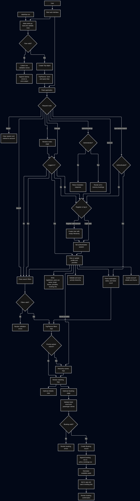

# BussBidder

Final class assessment for ACIT4420 Kyle Strother Student Number: 416279

## Description

BussBidder is a python backend project with a flask web application for browsing comparing and booking bus trips. Users can search trips by details such as destination, travel date, price, transfers, and available seats. Registered users can set their own priorities and save the weights associated with validation keeping it scored correctly. They can also see trips ranked against those preferences with a score out of 100 points on how much a trip matches their preferences, manage their account theme, and book tickets and see what they've booked. 

Trip data is loaded from a CSV file at startup. This data is provided and was originally drafted by AI to have consistent timing and accurate pricing. Each row is validated before it is added to the application's trip planner, Invalid rows are skipped and they're given a reason for rejection, these messages are written to `error.output`. 

## Project Structure

```text
BussBidder/
├── constants.py
├── dataLoader.py
├── main.py
├── priority.py
├── priorityHierarchy.py
├── scoreObject.py
├── tripsService.py
├── user.py
├── webInterface.py
├── data/
│   ├── PROJECT_FLOWCHART.md
│   ├── Flow_Diagram.png
│   ├── requirements.txt
│   └── trips.csv
├── static/
│   ├── Stylesheets for web interfaces
│   └── Javascript files for web interface interactions
├── templates/
│   └──.html Templates for all the different pages that include python scriptlets
└── testing/
    ├── data_loading/
        ├── Data files for testing against
        ├── Test_dataLoader_unittest.py
    └── trip_scoring/
        ├── test_trip_scoring_unittest.py
```

# Project Design Diagram




See the [project flowchart](data/Flow_Diagram.png) for a diagram of the main application paths.

## Python Modules

### `main.py`

The application entry point. It starts the Flask web interface by calling `run_web_interface()`.

### `dataLoader.py`

Loads trip records from CSV and validates their fields before creating `Trip` objects. Invalid rows are collected with a line number and reason and output to an error file while other records continue to run. This means that a few bad records doesn't prevent the program from running. 

The data provided has several failing rows to demonstrate how validation works and ensures data integrity.

### `tripsService.py`

Defines the `Trip` data object and `TripPlanner`.

Responsibilities:
- Stores trips loaded by the application.
- Parses search form values and reports invalid filters.
- Filters trips by user search criteria, to return a list of trips that meet specific desires to the pprogram.
- Appends successful booking records to `active_bookings.csv`.

### `priority.py`

Defines priority types, qualifiers, and evaluation methods. These structures establish how we weight priorities and determine how each priority should be good scaled based on its type. More information detailed in [Scoring](#scoring) for How it is deciding to weigh priorities

### `priorityHierarchy.py`

Stores a user's priorities and weights. It checks priority weight constraints and scores trips, returning them in descending score order.

This is also responsible for assigning a scoring object to a given trip that has been queried for against a users search criteria.

### `scoreObject.py`

Contains the score and per-priority score data objects used to present score breakdowns and overall score to trip relationship.

### `user.py`

Defines the `User` and `Booking` data objects. A user holds their account details, theme, priority hierarchy, and in-memory bookings.

### `constants.py`

Contains valid companies and destinations, available themes, the default theme, and the fields used to build the standard search form and process the data from the form to a `Trip` Objects fields.

### `webInterface.py`

Creates the Flask application and defines its routes.

Responsibilities:

- Renders the home, search, trip details, booking, account, and management pages.
- Handles account registration, login, profile updates, and logout.
- Validates and saves user priority preferences.
- Processes ticket bookings and displays booking confirmations.
- Exports registered users, themes, priorities, and booking IDs to `registered_users.csv`.
- Writes invalid trip-row messages to `error.output` during startup.

## Web Assets

- `templates/` contains the Jinja HTML pages rendered by Flask.
- `static/` contains shared and page-specific CSS and JavaScript.
- The booking page JavaScript creates passenger-name fields and updates the booking total as ticket counts change.
- The management page JavaScript supports editing the priority hierarchy.
- The search scripts manage flexible date ranges and the specialized-search tabs.

## Scoring

If a user says their hierarchy is for example  {Price, Flexibility, Low transfers, short duration, Departure time after 17:00} 
With this in mind we can allow them 100 points and to rank importance in respect to percent of points. For this example there are 5 trips as follows:

| company        | destination | travel_date | arrival_date | departure_time | arrival_time | duration_minutes | price_euro | transfers | luggage_allowance_kg | changeable | refundable | available_seats | customer_rating | rating_scale_max | environmental_measure_kg_co2e_per_passenger |   |
|----------------|-------------|-------------|--------------|----------------|--------------|------------------|------------|-----------|----------------------|------------|------------|-----------------|-----------------|------------------|---------------------------------------------|---|
| Camino Express | Barcelona   | 2026-11-03  | 2026-11-03   | 15:15          | 21:54        | 399              | 89.64      | 0         | 20                   | FALSE      | FALSE      | 15              | 4               | 5                | 25.04                                       |   |
| CostaLink      | Barcelona   | 2026-11-03  | 2026-11-03   | 13:30          | 21:34        | 484              | 60.25      | 0         | 20                   | FALSE      | TRUE       | 9               | 4.3             | 5                | 26.58                                       |   |
| VerdeBus       | Barcelona   | 2026-11-03  | 2026-11-03   | 11:00          | 19:33        | 513              | 63.56      | 0         | 25                   | FALSE      | FALSE      | 18              | 4.6             | 5                | 15.16                                       |   |
| NocheVia       | Barcelona   | 2026-11-03  | 2026-11-04   | 20:15          | 06:32        | 617              | 53.4       | 1         | 20                   | TRUE       | FALSE      | 17              | 4.3             | 5                | 19.99                                       |   |
| NocheVia       | Barcelona   | 2026-11-07  | 2026-11-08   | 21:15          | 07:38        | 623              | 57.22      | 1         | 20                   | FALSE      | TRUE       | 8               | 4.4             | 5                | 22.79                                       |   |

and assume the user gives ranking
1      Price	                                37
2	Flexibility	                                26
3	Low transfers	                        19
4	Short duration	                11
5	Departure time after 17:00	7

With this hierarchy we see two things: some are measured binarily, and others need a comparison to determine their quality (i.e what is a lower price).

If we determine average price, and duration of the trips given in a list we can compare the deviation from the average as the percent of its weighted points a prioroty is awarded
The trip with the lowest price should be given 100% of the 37 points while the average be given 18.5 and the most expensive be given 0
the same can be said for the duration and number of transfers

the binary ones are easy if it meets the criteria we give it whole portion of points so departure after a specific time is yes or no. 

Flexibility is slightly more complicated but we can categorize it as 60/40 refundability to changeability as it makes sense that refunds can be more valuable than changing a booking. So if a trip allows changes but not refunds it would get 40% of the 26 points given

with this specific scale and results we can say we have:
- max price of 89.64 and a min of 53.40 
- trip duration max: 623 min 399
- transfers max 1 and min 0

so now we can use the min max normalization formula $$X_{norm} = \frac{X - X_{min}}{X_{max} - X_{min}}$$ to determine relative value assign the maximum as either 0 or 1 depending on if a high normalization is good or bad. and what percent of the points each aspect should get 

### Trip 1: 
- high price is bad so this is giving us the following calculation:  $$price  =100 -  \left(\frac{89.64 - 53.40}{89.64 - 53.40} x 100\right)$$ =  0 so this one gets 0 of 37 points
- Flexibility is easy enough it has no refunds and no change so $$0.6\left( 0 \right)  + 0.4\left( 0 \right) = 0$$
- Transfers: there are none so  $$X_{transfers} = 100 - \left(  \frac{0 - 0}{1 - 0} x 100 \right) = 100$$ so we get all 19 points here
- Duration: this has the shortest duration so we have $$X_{duration} = 100 - \left(\frac{399 - 399}{623 - 399} x 100 \right) = 100$$ so we get all 11 points here
- Departure time after 17:00: this trip departs at 15:15 so it does not meet this expectation: so it gets 0% of 7

Trip 1: point total =  30 Not a great fit.

### Trip 2:
- Price:
$$Price = 100-\left(\frac{60.25-53.40}{89.64-53.40}\times100\right)=100-18.90=81.10$$
&#x20; This trip receives 81.10% of the 37 available points: $$0.8110\times37=\mathbf{30.01}$$
- Flexibility: This trip is refundable but not changeable. Refundability accounts for 60% of the flexibility score, while changeability accounts for 40%. $$0.6(1)+0.4(0)=0.6$$ This trip receives 60% of the 26 available points: $$0.6\times26=\mathbf{15.60}$$
- Transfers: There are no transfers, which is the minimum and therefore the best possible result in this dataset. $$X_{\text{transfers}}=100-\left(\frac{0-0}{1-0}\times100\right)=100$$
&#x20; This trip receives all 19 available points.
- Duration: This trip has a duration of 484 minutes. Since shorter durations are better, we normalize against the maximum duration of 623 minutes and minimum duration of 399 minutes. $$X_{\text{duration}}=100-\left(\frac{484-399}{623-399}\times100\right)=100-37.95=62.05$$
&#x20; This trip receives 62.05% of the 11 available points: $$0.6205\times11=\mathbf{6.83}$$
- Departure time after 17:00: This trip departs at 13:30, which does not meet the user's requirement. It receives 0% of the 7 available points.
Trip 2: point total = $$30.01 + 15.60 + 19 + 6.83 + 0 = 71.44$$.

A relatively good fit. The trip has a low price, refundability, no transfers, and a moderate duration, but it does not meet the preferred departure time.

### Trip 3: 

- Price: High price is bad, so we normalize against the maximum price of €89.64 and minimum price of €53.40. $$\text{Price}=100-\left(\frac{63.56-53.40}{89.64-53.40}\times100\right)=100-28.04=71.96$$
&#x20; This trip receives 71.96% of the 37 available points: $$0.7196\times37=\mathbf{26.62}$$
- Flexibility: This trip is neither refundable nor changeable. $$0.6(0)+0.4(0)=0$$
&#x20; This trip receives 0 of the 26 available points.
- Transfers: There are no transfers, which is the minimum and therefore the best possible result. $$X_{\text{transfers}}=100-\left(\frac{0-0}{1-0}\times100\right)=100$$
&#x20; This trip receives all 19 available points.
- Duration: This trip has a duration of 513 minutes. Since shorter durations are better, we normalize against the maximum duration of 623 minutes and minimum duration of 399 minutes. $$X_{\text{duration}}=100-\left(\frac{513-399}{623-399}\times100\right)=100-50.89=49.11$$
&#x20; This trip receives 49.11% of the 11 available points: $$0.4911\times11=\mathbf{5.40}$$
- Departure time after 17:00: This trip departs at 11:00, which does not meet the user's requirement. It receives 0% of the 7 available points.
Trip 3: point total = $$26.62 + 0 + 19 + 5.40 + 0 = 51.02$$.

A moderate-to-low fit. The trip offers a reasonable price and no transfers, but it lacks flexibility, has a relatively long duration, and departs much earlier than the preferred time.

### Trip 4:

- Price: High price is bad, so we normalize against the maximum price of €89.64 and minimum price of €53.40. $$\text{Price}=100-\left(\frac{53.40-53.40}{89.64-53.40}\times100\right)=100-0=100$$
&#x20; This trip receives all 37 available points.
- Flexibility: This trip is changeable but not refundable. $$0.6(0)+0.4(1)=0.4$$
&#x20; This trip receives 40% of the 26 available points: $$0.4\times26=\mathbf{10.40}$$
- Transfers: There is one transfer, which is the maximum in this dataset and therefore the worst result. $$X_{\text{transfers}}=100-\left(\frac{1-0}{1-0}\times100\right)=0$$
&#x20; This trip receives 0 of the 19 available points.
- Duration: This trip has a duration of 617 minutes. Since shorter durations are better, we normalize against the maximum duration of 623 minutes and minimum duration of 399 minutes. $$X_{\text{duration}}=100-\left(\frac{617-399}{623-399}\times100\right)=100-97.32=2.68$$
&#x20; This trip receives 2.68% of the 11 available points: $$0.0268\times11=\mathbf{0.29}$$
- Departure time after 17:00: This trip departs at 20:15, which meets the user's requirement. It receives all 7 available points.
Trip 4: point total = $$37 + 10.40 + 0 + 0.29 + 7 = 54.69$$.

A moderate fit. The trip has the lowest price and meets the departure-time requirement, with some flexibility through changes. However, it has one transfer and the longest overnight journey among the trips departing on November 3.

### Trip 5:

- Price: High price is bad, so we normalize against the maximum price of €89.64 and minimum price of €53.40. $$\text{Price}=100-\left(\frac{57.22-53.40}{89.64-53.40}\times100\right)=100-10.54=89.46$$
&#x20; This trip receives 89.46% of the 37 available points: $$0.8946\times37=\mathbf{33.10}$$
- Flexibility: This trip is refundable but not changeable. $$0.6(1)+0.4(0)=0.6$$
&#x20; This trip receives 60% of the 26 available points: $$0.6\times26=\mathbf{15.60}$$
- Transfers: There is one transfer, which is the maximum in this dataset and therefore the worst result. $$X_{\text{transfers}}=100-\left(\frac{1-0}{1-0}\times100\right)=0$$
&#x20; This trip receives 0 of the 19 available points.
- Duration: This trip has a duration of 623 minutes, which is the maximum and therefore the worst result in this dataset. $$X_{\text{duration}}=100-\left(\frac{623-399}{623-399}\times100\right)=0$$
&#x20; This trip receives 0 of the 11 available points.
- Departure time after 17:00: This trip departs at 21:15, which meets the user's requirement. It receives all 7 available points.
Trip 5: point total = $$33.10 + 15.60 + 0 + 0 + 7 = 55.70$$.

A moderate fit. The trip offers a low price, refundability, and a late departure, but it has one transfer and the longest duration in the dataset. 

### Final ranking

| Rank | Trip                   | Compatibility score |
| ---- | ---------------------- | ------------------- |
| 1    | CostaLink — Nov 3      | 71.44               |
| 2    | NocheVia — Nov 7       | 55.70               |
| 3    | NocheVia — Nov 3       | 54.69               |
| 4    | VerdeBus — Nov 3       | 51.02               |
| 5    | Camino Express — Nov 3 | 30.00               |

using this methodology We can determine the scoring of each trip given a users lists of priorities and then compare each of them

## Assumptions and Limitations

- Trip data is provided in `data/trips.csv` and uses the expected CSV columns.
- Trip travel and arrival dates must not be earlier than the current date.
- A booking requires a valid ticket count within the available seat count and a passenger name for each ticket.
- User accounts and current trip-seat counts are held in memory and are reset when the application restarts.
- Booking records are appended to `active_bookings.csv` in the directory from which the application is run. These are also accessible in the web interface if a user logins in as the built in admin user `admin@bb_admin.com` with the built in password `HugeSecurityRisk` Because there are no other admin controls added this is an okay approach to show bookings in page as it doesnt contain any sensative information, and the scope of this assignment did not necessitate user controls on this scale.
- `registered_users.csv` is regenerated when an authenticated user opens or submits the account management page. It contains user names, emails, themes, priorities, and booking IDs.
- The account and booking setup is intended for a course project/demo, and as such security behaviors are much more relaxed.

## Installation

### Prerequisites

- Python 3.10 or newer.
- pip for installing dependencies
- Flask 3.x

### Steps

1. Clone the repository and change into the project directory:

   ```bash
   git clone https://github.com/kstro9605/ACIT4420-BussBidder.git
   cd ACIT4420-BussBidder
   ```

2. Install the required package:

   ```bash
   python -m pip install -r data/requirements.txt
   ```

3. Start the application from the project directory:

   ```bash
   python main.py
   ```

4. Open [http://127.0.0.1:8000](http://127.0.0.1:8000) in a browser.

## Running Tests

From the project directory, run:

```bash
python -m unittest testing.data_loading.test_dataLoader_unittest testing.trip_scoring.test_trip_scoring_unittest
```
